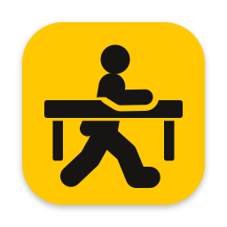

<p align="center"></p>

# deskman

[English](README.md) | 日本語

macOS のデスクトップ（Spaces）に名前を付けて、名前で瞬時に移動する小さなツール。名前は各デスクトップの UUID に紐づくので、並べ替えや増減があってもずれない。

## インストール

Homebrew で入れる。macOS 14 以降、Apple Silicon 専用。

```sh
brew install --cask todayporton/tap/deskman
```

Deskman.app が `/Applications` に、`deskman` コマンドが Homebrew の bin に入る。

Developer ID の署名と公証はしていないので、初回の起動は Gatekeeper に止められる。次の手順で開く。

1. 開けなかったことを知らせるダイアログで「完了」を押す。
2. システム設定 > プライバシーとセキュリティ の下のほうにある「このまま開く」を押す。
3. 確認のダイアログでもう一度「このまま開く」を押し、パスワードを入力する。

移動には Deskman.app の常駐とアクセシビリティ権限が必要。起動したら、システム設定 > プライバシーとセキュリティ > アクセシビリティ で Deskman.app を許可する。メニューの「Launch at Login」で自動起動にできる。アプリのメニューとメッセージは英語で表示される。

メニューバーには、カーソルのあるディスプレイで表示中のデスクトップが出る。カーソルが別のディスプレイへ移るとすぐに切り替わる。何を出すかはメニューの「Menu Bar Shows」で選ぶ。名前、番号（Mission Control と同じく全ディスプレイを通した番号で、2桁分の固定幅）、アイコンだけ、のいずれか。

Mission Control では、各デスクトップの名前を、そのデスクトップの真上の画面上端に、ノッチの形で上から降ろして出す（名前がなければ「Desktop 番号」、フルスクリーンのデスクトップはそのまま）。デスクトップの位置は Dock から読み、Mission Control が開いているかを 0.1 秒ごとに確かめる。メニューの「Show Names in Mission Control」で止められる。

`deskman go` はローカルソケットで常駐アプリに移動を依頼する。権限は Deskman.app だけにあればよく、ターミナルや Herdr には不要。

### ソースからビルドする

```sh
bash scripts/bundle.sh
cp -R dist/Deskman.app /Applications/
ln -s /Applications/Deskman.app/Contents/MacOS/deskman ~/.local/bin/deskman
```

`scripts/bundle.sh` の既定はアドホック署名で、再ビルドして置き換えると許可し直しが必要になることがある。`CODESIGN_IDENTITY="証明書の名前" bash scripts/bundle.sh` のように自分の証明書で署名すれば、再ビルドしても同じアプリとして扱われる想定。

## 使い方

```
deskman                         メニューバーアプリとして起動
deskman list [--json] [--all]   一覧（* は現在地、+ は他のディスプレイで表示中）
deskman current [--json]        現在のデスクトップ
deskman go [--restore-cursor] [--restore-focus] <名前|番号|UUID>
                                移動
deskman next [--wrap] [--cursor] [--restore-cursor] [--restore-focus]
                                右隣へ移動
deskman prev [--wrap] [--cursor] [--restore-cursor] [--restore-focus]
                                左隣へ移動
deskman move [--stay] [--wrap] <名前|番号|UUID|next|prev>
                                フォーカスのあるウィンドウを別のデスクトップへ運ぶ
deskman rename <対象> <名前>    名前を付ける（"" で解除）
deskman rename --forget <名前>  一覧にない名前を消す
```

`next` と `prev` は、既定ではアクティブなウィンドウのあるディスプレイで、`--cursor` を付けるとカーソルのあるディスプレイで隣へ移動する。他のディスプレイへは進まず、端では終了コード 2 で失敗する。`--wrap` を付けると反対の端へ回り込む。フルスクリーンのデスクトップも並びどおりに数える。連続で呼ぶと、呼んだ回数だけ進む。

`--restore-cursor` は、移動のためにカーソルを別のディスプレイへ動かした場合に、移動後に元の位置へ戻す。`--restore-focus` は、移動でキーボードのフォーカスが他のウィンドウへ移った場合に、移動前のウィンドウへ戻す。戻すのは移動前のウィンドウが画面に出ているときだけで、移動のコマンドはフォーカスを戻すのを待たずに終わる。次の移動が始まると、戻す処理は取りやめる。

`move` は、フォーカスのあるウィンドウを同じディスプレイのデスクトップへ運び、自分も一緒に移る。`--stay` を付けると、ウィンドウだけを送って元のデスクトップへ戻る。`next` と `prev` は隣のデスクトップを指し、「next」「prev」という名前のデスクトップより優先する（そのデスクトップには UUID を使う）。`--wrap` を付けると端で反対側へ回り込む。ウィンドウをタイトルバーで掴み、「左／右の操作スペースに移動」のショートカット（システム設定 > キーボード > キーボードショートカット > Mission Control）で切り替える。既定は Control+矢印で、キーを変えていればそのキーを読んで使う。ショートカットがオフなら、運ぶ間だけオンにして元に戻すので、オフのままでよい。`move` のデスクトップの切り替えは、`go` と違って瞬時ではない。ウィンドウを掴んでいる間はスワイプの合成が効かないため、アニメーションが付き、1 つ進むごとに約 0.35 秒かかる（`--stay` で元へ戻るときは瞬時）。タイトルバーのないウィンドウ、フルスクリーンのウィンドウ、フルスクリーンのデスクトップや別のディスプレイへの移動、ショートカットにキーがない場合は、終了コード 8 で断る。途中で失敗したときは、元のデスクトップへ戻る。

番号は今の並びの順番なので、並べ替えるとずれる。ずらしたくない呼び出しでは名前か UUID を使う。

## 終了コード

| コード | 意味 |
|---|---|
| 0 | 成功 |
| 1 | その他のエラー |
| 2 | 見つからない（`next`/`prev` では端にいる） |
| 3 | 今の一覧にない（ディスプレイが外れている、または削除された） |
| 4 | アクセシビリティ権限がない |
| 5 | 移動を確認できない（`move` では、ウィンドウが移ったことを確認できない） |
| 6 | 名前の重複 |
| 7 | Deskman.app が起動していない（`move` では、起動中のものが古くてウィンドウを運べないときも） |
| 8 | ウィンドウを運べない（フォーカスのあるウィンドウやタイトルバーがない、フルスクリーン、別のディスプレイ、ショートカットにキーがない） |
| 64 | 引数の誤り |

## 制限

- macOS の非公式 API（`CGSCopyManagedDisplaySpaces`、Dock スワイプの合成）に依存するので、macOS の更新で動かなくなることがある。macOS 27 で変わったイベントの形式にも対応したが、macOS 27 では動作を確認していない。
- UUID が空のデスクトップには名前を付けられない。
- スワイプはカーソルのあるディスプレイに効くので、カーソルが移動先と別のディスプレイにあるときは、既定でカーソルも移動先へ動く。`--restore-cursor` で元に戻せる。

## データ

`~/.config/deskman/` に保存する。消すにはこのフォルダを削除する。

## 謝辞

スワイプ合成の手法は [InstantSpaceSwitcher](https://github.com/jurplel/InstantSpaceSwitcher)（MIT）と [yabai](https://github.com/koekeishiya/yabai)（MIT）を参考にした。

## ライセンス

MIT。`LICENSE` を参照。
