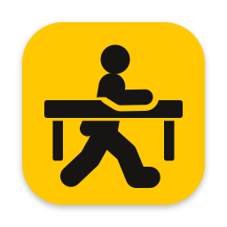

<p align="center"></p>

# deskman

English | [日本語](README.ja.md)

A small tool that names macOS desktops (Spaces) and switches to them instantly by name. Names are tied to each desktop's UUID, so they stay correct when desktops are reordered, added or removed.

## Installation

Install with Homebrew. Requires macOS 14 or later on Apple Silicon.

```sh
brew install --cask todayporton/tap/deskman
```

This puts Deskman.app in `/Applications` and the `deskman` command in Homebrew's bin directory.

The app is not signed with a Developer ID or notarized, so Gatekeeper blocks the first launch. To open it:

1. Click "Done" in the dialog saying the app could not be opened.
2. Open System Settings > Privacy & Security and click "Open Anyway" near the bottom.
3. Click "Open Anyway" again in the confirmation dialog and enter your password.

Switching needs Deskman.app running and granted Accessibility access. After launching it, allow Deskman.app in System Settings > Privacy & Security > Accessibility. Choose "Launch at Login" in its menu to start it automatically.

The menu bar shows the desktop on the display under the cursor, and changes as soon as the cursor moves to another display. Choose what it shows from "Menu Bar Shows" in the menu: the name, the number (counted across all displays, as in Mission Control, with a fixed width that fits two digits), or only an icon.

In Mission Control, Deskman shows each desktop's name at the top edge of the screen, above the desktop, in a notch-shaped tab that slides down (unnamed desktops show "Desktop N"; full-screen ones are left as they are). Deskman reads the desktop positions from the Dock, checking whether Mission Control is open every 0.1 seconds. Turn this off with "Show Names in Mission Control" in the menu.

`deskman go` asks the running app to switch over a local socket. Only Deskman.app needs the permission; your terminal or Herdr does not.

### Building from source

```sh
bash scripts/bundle.sh
cp -R dist/Deskman.app /Applications/
ln -s /Applications/Deskman.app/Contents/MacOS/deskman ~/.local/bin/deskman
```

By default `scripts/bundle.sh` signs ad hoc, so replacing the app with a new build may require granting the permission again. Signing with your own certificate, as in `CODESIGN_IDENTITY="certificate name" bash scripts/bundle.sh`, lets macOS treat rebuilds as the same app.

## Usage

```
deskman                         Run as a menu bar app
deskman list [--json] [--all]   List desktops (* current, + shown on another display)
deskman current [--json]        Show the current desktop
deskman go [--restore-cursor] [--restore-focus] <name|number|UUID>
                                Switch to a desktop
deskman next [--wrap] [--cursor] [--restore-cursor] [--restore-focus]
                                Switch to the desktop on the right
deskman prev [--wrap] [--cursor] [--restore-cursor] [--restore-focus]
                                Switch to the desktop on the left
deskman move [--stay] [--wrap] <name|number|UUID|next|prev>
                                Move the focused window to another desktop
deskman rename <target> <name>  Name a desktop ("" removes the name)
deskman rename --forget <name>  Remove a name that is not in the list
```

By default, `next` and `prev` move within the display that has the active window; with `--cursor`, within the display under the cursor. They do not continue onto other displays and fail with exit code 2 at the edge. With `--wrap`, they wrap around to the other end. Full-screen desktops count in their place in the order. Repeated calls advance once per call.

`--restore-cursor` moves the cursor back after a switch that had to move it to another display. `--restore-focus` returns keyboard focus to the previous window if the switch moved it elsewhere. Focus is returned only when the previous window is on screen, and the command finishes without waiting for it. A new switch cancels a pending focus return.

`move` carries the focused window to a desktop on the same display, and you go with it. With `--stay`, the window goes and you come back. `next` and `prev` mean the neighbouring desktop (they take precedence over desktops named "next" or "prev"; use the UUID for those), and `--wrap` wraps around at the edge. It holds the window by its title bar and switches with the "Move left a space" and "Move right a space" shortcuts (System Settings > Keyboard > Keyboard Shortcuts > Mission Control), Control+Arrow by default. Deskman reads the keys you assigned, and if the shortcuts are off it turns them on only while the window is carried, so they can stay off. Switching desktops with `move` is not instant, unlike `go`: synthetic swipes do not work while a window is held, so the switch animates and takes about 0.35 seconds per desktop passed (with `--stay`, the return trip is instant). Windows without a title bar, full-screen windows, full-screen destinations, other displays and shortcuts with no key assigned are refused with exit code 8. If the move fails partway, Deskman switches back to where it started.

Numbers follow the current order and change when desktops are reordered. Use a name or UUID in calls that must not shift.

## Exit codes

| Code | Meaning |
|---|---|
| 0 | Success |
| 1 | Other error |
| 2 | Not found (for `next`/`prev`, already at the edge) |
| 3 | Not in the current list (its display is disconnected, or it was removed) |
| 4 | No Accessibility permission |
| 5 | Could not confirm the switch (for `move`, that the window moved) |
| 6 | Duplicate name |
| 7 | Deskman.app is not running (for `move`, also when the running one is too old to move windows) |
| 8 | The window cannot be moved (no focused window or title bar, full screen, another display, or no key for the shortcuts) |
| 64 | Invalid arguments |

## Limitations

- Depends on private macOS APIs (`CGSCopyManagedDisplaySpaces` and synthesized Dock swipes), so a macOS update may break it. The event format that changed in macOS 27 is supported, but it has not been tested on macOS 27.
- Desktops with an empty UUID cannot be named.
- Swipes act on the display under the cursor, so when the cursor is on a different display from the target, the cursor moves to the target display by default. `--restore-cursor` moves it back.

## Data

Stored in `~/.config/deskman/`. Delete this folder to remove it.

## Acknowledgements

The swipe synthesis technique is based on [InstantSpaceSwitcher](https://github.com/jurplel/InstantSpaceSwitcher) (MIT) and [yabai](https://github.com/koekeishiya/yabai) (MIT).

## License

MIT. See `LICENSE`.
